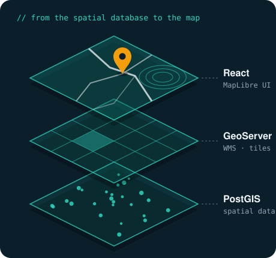

  

  Based in São José dos Campos, Brazil 🇧🇷
    
  I build geointelligence software for the public sector and turn complex business rules into
  <strong>reliable, scalable products</strong>, from the spatial database to the map on the screen.

### About me

- 🧭 **5+ years** building full-stack web platforms
- 🏛️ Cloud GIS SaaS for municipal real estate cadastre and taxation
- 🧪 TDD and an AI-first workflow for planning and architecture
- 🎓 Postgraduate in Software Engineering at PUC Minas *(in progress)*
- 💬 Ask me about **PostGIS, GeoServer and Spring Boot**

 

## Highlights

| Impact | What I did |
|---|---|
| 🗺️ **Geographic data versioning** | Designed and built a pull-request-style review flow for map entities: propose, compare, edit, approve or reject with justification before publishing. Only validated, official data reaches citizens and municipal managers. |
| 🏛️ **Official data approval pipeline** | Architected a governance system for property records where every change to lots and taxes goes through sequential validation stages and is promoted to the official version only after final approval. |
| ⚡ **60% faster load time** | Cut the home screen's average load time by parallelizing async calls in React (`Promise.all`) and consolidating several processes into a single Spring Boot endpoint. |
| 📦 **200k+ entities in 2 minutes** | Rewrote a large-scale import with 10k-record batch inserts and leaner processing loops. |
| 🌦️ **Weather geovisualization** | Built forecast maps from meteorological models (GFS/WMS) with dynamic filters that isolate, in real time, only the regions matching user-defined conditions (e.g. 10–20 °C), plus dashboard alerts that pinpoint where critical thresholds (e.g. winds above 20 knots) are reached. |

## Tech stack

#### Backend

&nbsp;
&nbsp;
&nbsp;
&nbsp;
&nbsp;

#### Frontend

&nbsp;
&nbsp;
&nbsp;
&nbsp;

#### Data & GIS

&nbsp;
&nbsp;
&nbsp;
&nbsp;

#### Tools & practices

&nbsp;
&nbsp;
&nbsp;
&nbsp;
&nbsp;

## Experience

**Geopixel** · Software Developer · ~1.5 years 
Full-stack product engineering on a cloud GIS SaaS for municipal real estate cadastre: territorial and tax
modules with React, TypeScript, Java/Spring Boot and Python/Django, integrated with PostGIS and GeoServer.
Spatial queries in PostGIS, map data validation in QGIS, TDD and an AI-first delivery workflow. Started in
N3 support, diagnosing and permanently fixing high-complexity incidents.

**IACIT Soluções Tecnológicas** · Software Developer · 4+ years 
Full lifecycle of critical web applications, from requirements to maintenance, with React/Next.js,
Java/Spring Boot and Python/Django. Automated ingestion of meteorological models, route security and
authentication, sprint planning and technical documentation.

## Featured project

**[Gaia](https://gaia.avelar.dev)**: my own web map application, built with MapLibre and OpenStreetMap tiles.

## Education

- **Postgraduate in Software Engineering**, PUC Minas *(in progress)*: DevOps/DevSecOps, DDD, API security, GenAI for testing and documentation
- **Associate degree in Systems Analysis and Development**, Fatec São José dos Campos
- **Bachelor's in Mechanical Engineering**, ETEP

## Contact

&nbsp;

 

Most of my professional work lives in private company repositories, so it does not show up in the contribution graph.

